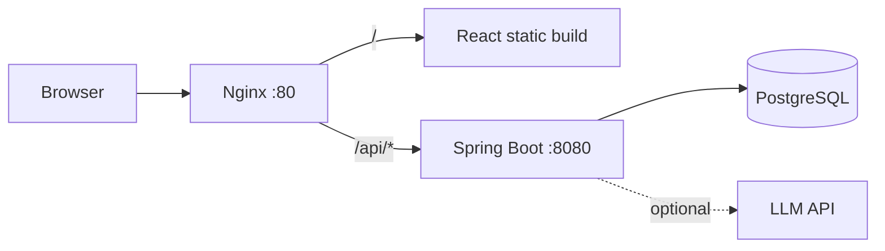

# CarbonTrack

A carbon emission tracking platform for Indian companies. A company logs monthly activity data per facility (electricity, fuel, travel, freight, waste). CarbonTrack converts it to CO2e using published emission factors, shows dashboards, tracks reduction targets, awards a simulated green incentive tier, and adds AI features: forecasting, anomaly detection, and an assistant.

It follows the GHG Protocol: Scope 1 (direct fuel use), Scope 2 (purchased electricity), Scope 3 (travel, freight, waste).

**Live demo:** `<add the deployed link here>`
**API docs (Swagger):** `<live link>/swagger-ui.html`

| Demo login | Email | Password | Role |
|---|---|---|---|
| Admin | `demo@carbontrack.in` | `Demo@1234` | ADMIN |
| Analyst | `analyst@carbontrack.in` | `Demo@1234` | ANALYST |

> The demo company (GreenSteel Industries Ltd) and its activity data are fictional and generated by a seeder. The incentive scheme is simulated for this project. It is not a real government scheme.

## Screenshots

`<add screenshots: dashboard, activities, targets, incentives, AI insights>`

## Features

- **Multi-tenant auth:** register a company, log in with JWT, and see only your own company's data. Two roles: ADMIN and ANALYST.
- **Facilities:** manage offices, plants, warehouses, and data centres.
- **Activity records:** add, filter, and delete monthly records. CO2e is calculated on save, and each record keeps the factor it used.
- **Dashboard:** KPI cards, monthly trend by scope, split by category, split by facility, and change against the previous year.
- **Targets:** set a reduction target against a baseline year and see progress and status (ACHIEVED, ON_TRACK, AT_RISK).
- **Green incentives (simulated):** a tier (BRONZE, SILVER, GOLD) based on the reduction against the baseline year, with the gap to the next tier.
- **AI insights:**
  - Forecast of the next 1 to 12 months, with a confidence band
  - Anomaly detection on activity records
  - Assistant that answers questions from the company's own data
- **Seeded demo data:** one company, four facilities, and monthly data from January 2023 to October 2026.

## Architecture



The frontend and backend share one origin in production. Nginx serves the React build and proxies `/api` to the backend. Postgres is reachable only inside the Docker network.

The backend is a modular monolith. Each package is one module with its own controller, service, and repository.

## Tech stack

| Part | Choice |
|---|---|
| Backend | Java 21, Spring Boot 3, Spring Security (JWT), Spring Data JPA, Flyway, Maven |
| Database | PostgreSQL 16 |
| AI | Apache Commons Math, plain Java statistics, one optional LLM call over HTTP |
| Frontend | React 18, Vite, TypeScript, Tailwind CSS, React Router, Axios, Recharts |
| API docs | springdoc-openapi (Swagger UI) |
| Deploy | Docker, Docker Compose, Nginx, AWS EC2, GitHub Actions, GHCR |
| Tests | JUnit 5, Mockito |

## Repository structure

```
carbontrack/
├─ backend/
│  ├─ src/main/java/com/carbontrack/
│  │  ├─ common/        security, JWT, error handling, enums
│  │  ├─ auth/          register, login
│  │  ├─ company/       company entity
│  │  ├─ facility/      facilities CRUD
│  │  ├─ factor/        emission factors
│  │  ├─ calculation/   emission calculation engine
│  │  ├─ activity/      activity records
│  │  ├─ dashboard/     aggregations
│  │  ├─ target/        reduction targets
│  │  ├─ incentive/     incentive rules and status
│  │  ├─ ai/            forecast, anomalies, assistant
│  │  └─ seed/          demo data seeder
│  ├─ src/main/resources/db/migration/   Flyway migrations
│  └─ Dockerfile
├─ frontend/
│  ├─ src/              api, auth, components, pages, utils, mocks
│  └─ Dockerfile
├─ deploy/              nginx.conf, docker-compose.prod.yml, .env.example, smoke.sh
├─ docker-compose.yml   local Postgres
├─ .github/workflows/   ci.yml, deploy.yml
└─ docs/                team briefs and the shared API contract
```

## Run locally

**You need:** Java 21, Node.js 20 or later, Docker.

1. **Clone the repo**
   ```bash
   git clone <repo-url>
   cd carbontrack
   ```

2. **Start Postgres**
   ```bash
   docker compose up -d
   ```

3. **Start the backend**
   ```bash
   cd backend
   ./mvnw spring-boot:run
   ```
   Flyway creates the schema and reference data. The seeder creates the demo company on the first run. The API is at `http://localhost:8080/api` and Swagger UI is at `http://localhost:8080/swagger-ui.html`.

4. **Start the frontend**
   ```bash
   cd frontend
   npm install
   npm run dev
   ```
   Open `http://localhost:5173`. The dev server proxies `/api` to the backend.

5. **Log in** with a demo account from the table at the top.

To work on the frontend without the backend, set `VITE_USE_MOCKS=true` in `frontend/.env.local`.

## Environment variables

The backend has local defaults that match the root `docker-compose.yml`, so nothing is needed for local development. Set these in production.

| Variable | Used by | Purpose |
|---|---|---|
| `DB_URL` | backend | JDBC URL, for example `jdbc:postgresql://db:5432/carbontrack` |
| `DB_USERNAME`, `DB_PASSWORD` | backend, db | Database login |
| `JWT_SECRET` | backend | Signing key, 64 or more random characters |
| `JWT_EXPIRY_MINUTES` | backend | Token lifetime, for example `1440` |
| `APP_SEED_ENABLED` | backend | `true` creates the demo company on startup |
| `CORS_ALLOWED_ORIGINS` | backend | Local development only, for example `http://localhost:5173` |
| `LLM_BASE_URL`, `LLM_API_KEY`, `LLM_MODEL` | backend | Any OpenAI-compatible chat endpoint. Leave blank for rule-based answers. |
| `VITE_API_BASE_URL` | frontend | API base path, `/api` by default |
| `VITE_USE_MOCKS` | frontend | `true` serves local mock data |

Never commit real secrets. Copy `deploy/.env.example` to `.env` on the server and fill it in there.

## How emissions are calculated

```
co2eKg = quantity × emission factor (kg CO2e per unit)
```

- Each category has a fixed unit and scope. The client sends only the category and quantity.
- For a record's year, the engine picks the factor with the latest year at or before it. It prefers the India factor, then the global one.
- All values are stored in kg. The UI shows tonnes for large values.

| Category | Unit | Scope |
|---|---|---|
| Electricity | kWh | 2 |
| Diesel | litre | 1 |
| Petrol | litre | 1 |
| Natural gas | m3 | 1 |
| LPG | kg | 1 |
| Business travel (air) | passenger km | 3 |
| Business travel (road) | km | 3 |
| Freight (road) | tonne km | 3 |
| Waste to landfill | tonne | 3 |

**Targets:** the target emission is the baseline year total reduced by the target percentage. A target is ACHIEVED when the current year is at or below it, ON_TRACK when the reduction so far is at least the straight-line pace, and AT_RISK otherwise.

**Incentives:** the tier is the highest rule whose minimum reduction against the baseline year is met. BRONZE needs 5%, SILVER 10%, GOLD 20%.

## Data sources

| Data | Source |
|---|---|
| Indian grid electricity factor | [CEA CO2 Baseline Database for the Indian Power Sector](https://cea.nic.in/wp-content/uploads/2021/03/User_Guide_Version_20.0.pdf) (CO2 only) |
| Fuel, travel, freight, and waste factors | [UK Government GHG Conversion Factors for Company Reporting](https://www.gov.uk/government/collections/government-conversion-factors-for-company-reporting) |
| Company activity data | Generated by `seed/DemoDataSeeder` with a fixed random seed. It is not real company data. |

The factor values and their source editions are in `backend/src/main/resources/db/migration/` and are shown in the app through `GET /api/factors`. The UK factors are used as a general reference for categories where no India-specific factor is loaded.

## AI features

| Feature | Method |
|---|---|
| Forecast | Linear trend on monthly totals, multiplied by a seasonal index for each calendar month. The band is the forecast ± 1.96 × the residual standard deviation. Needs at least 12 months of history. |
| Anomalies | Z-score of each record's quantity within its facility and category group. A record is flagged at an absolute z-score of 2.5 or more, and marked HIGH at 3.5 or more. |
| Assistant | Builds a short summary of the company's data and sends it with the question to an LLM. If no API key is set or the call fails, it returns a rule-based answer from the same summary. The response says which one was used. |

## API overview

Base path `/api`. Send `Authorization: Bearer <token>` on every route except register, login, and health. The full contract is in `docs/` and in Swagger UI.

| Area | Routes |
|---|---|
| Health | `GET /health` |
| Auth | `POST /auth/register`, `POST /auth/login`, `GET /auth/me` |
| Facilities | `GET, POST /facilities`, `PUT, DELETE /facilities/{id}` |
| Emission factors | `GET /factors` |
| Activities | `GET, POST /activities`, `PUT, DELETE /activities/{id}` |
| Dashboard | `GET /dashboard/years`, `/summary`, `/monthly`, `/by-category`, `/by-facility` |
| Targets | `GET, POST /targets`, `DELETE /targets/{id}` |
| Incentives | `GET /incentives/rules`, `GET /incentives/status` |
| AI | `GET /ai/forecast`, `GET /ai/anomalies`, `POST /ai/assistant` |

Errors return one shape:

```json
{ "timestamp": "2026-11-11T10:00:00Z", "status": 400, "error": "Bad Request", "message": "quantity must be positive", "path": "/api/activities" }
```

## Tests

```bash
cd backend && ./mvnw verify
cd frontend && npm run build
```

Unit tests cover factor selection, target status, and incentive tier logic.

## Deployment

The app runs on one AWS EC2 instance as a Docker Compose stack with three services: `db`, `backend`, and `web` (Nginx with the React build). Only port 80 is public.

**CI/CD with GitHub Actions**
- `ci.yml` runs on every pull request: backend `mvn verify` and frontend build.
- `deploy.yml` runs on every push to `main`: it builds both images, pushes them to GHCR, pulls them on the server, restarts the stack, and runs `deploy/smoke.sh`.

**Manual deploy on the server**
```bash
cd /opt/carbontrack
docker compose -f docker-compose.prod.yml pull
docker compose -f docker-compose.prod.yml up -d
```

Database changes go through new Flyway migrations. Never edit a migration that has already run.

## Roadmap

- CSV upload of activity records
- Reduction actions log
- PDF sustainability report in a BRSR-style layout
- Simulated IoT meter feed
- Demo data scaled to a listed company's publicly disclosed BRSR totals
- HTTPS with a custom domain

## Team

| Member | Role |
|---|---|
| Saneh | Frontend |
| Guransh | Backend and integration |
| Manit | Deployment, CI/CD, seed data, AI endpoints |

## Disclaimer

This is an academic project. The emission figures it produces are estimates for demonstration and are not suitable for regulatory reporting.
